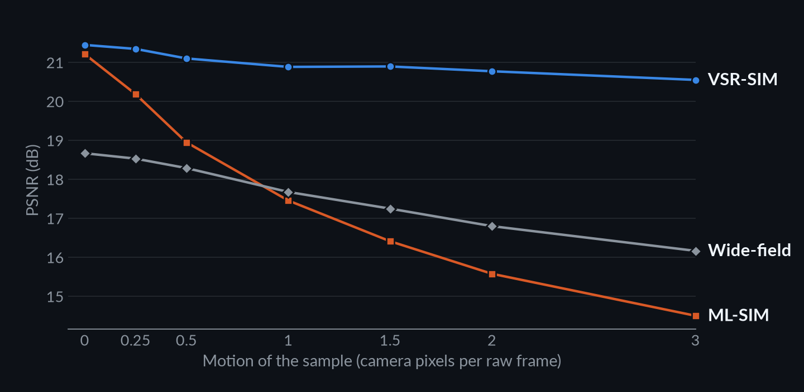
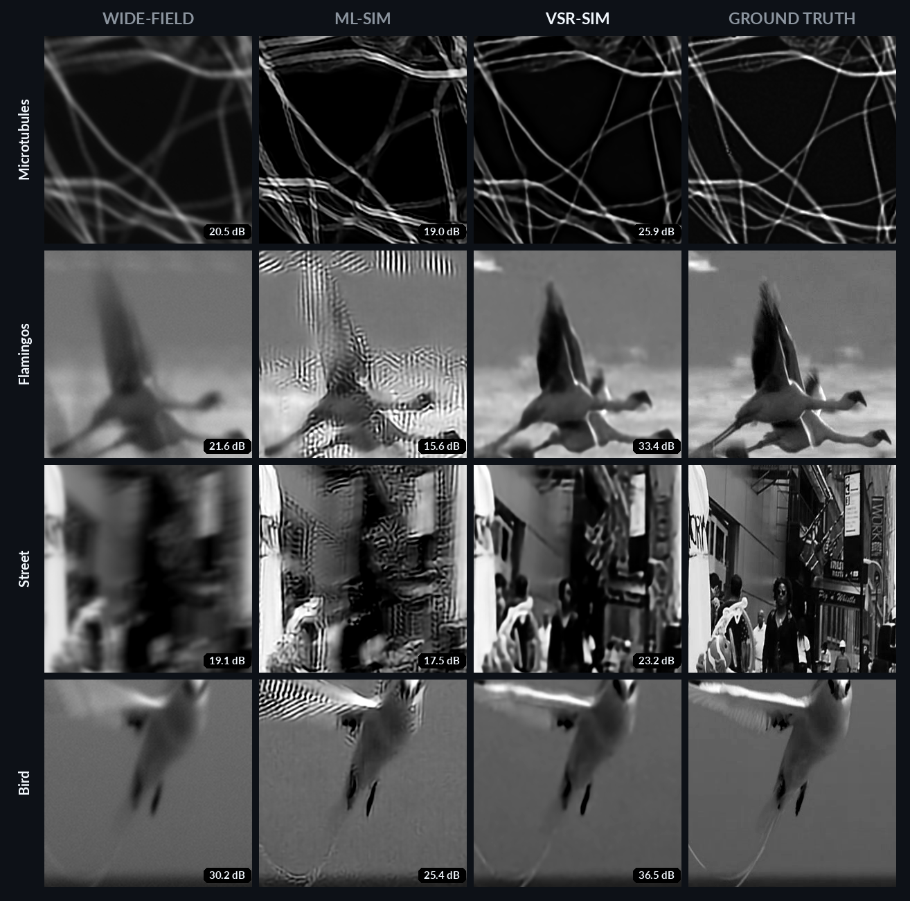
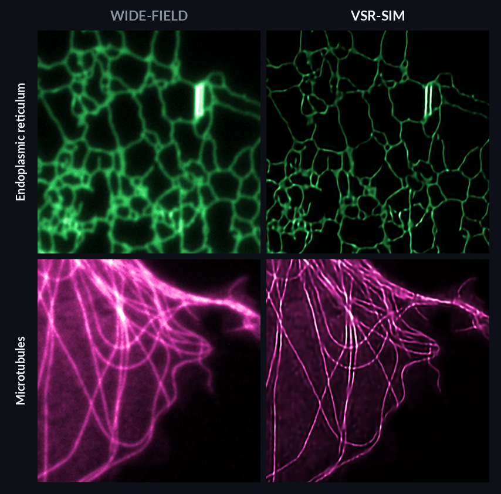
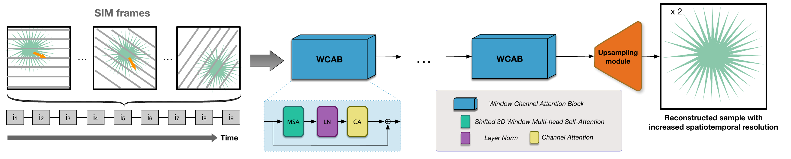
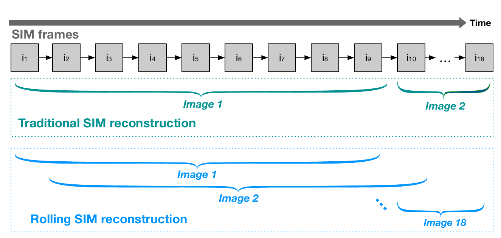

<h1 align="center">VSR-SIM</h1>

<p align="center">
  <b>Super-resolution microscopy for samples that will not hold still.</b><br>
  A video transformer that reconstructs structured illumination microscopy through motion,<br>
  and returns an image for every raw frame instead of one for every nine.
</p>

<p align="center">
  <a href="https://arxiv.org/abs/2203.00030"></a>
  <a href="https://github.com/charlesnchr/VSR-SIM/releases/tag/v1.0"></a>
  <a href="LICENSE"></a>
</p>

<p align="center">
  
</p>
<p align="center">
  <sub>A simulated acquisition of microtubules that move one camera pixel per raw frame, with beads on paths of their own. The first three panels come from the same raw frames, and ML-SIM reconstructs each stack of nine on its own. Run <code>python reconstruct.py --rolling examples/Sequence_microtubules.tif</code> to reproduce the VSR-SIM panel.</sub>
</p>

Structured illumination microscopy (SIM) doubles the resolution of a fluorescence microscope, with little enough light to image living cells. The catch is that one super-resolved image takes nine exposures, and the reconstruction assumes that the sample held still for all nine. Living cells do not. Whatever moved between the first exposure and the last comes out doubled, smeared or covered in stripes. The usual way round it is a shorter exposure, which costs signal.

VSR-SIM treats the nine exposures as a short video. A transformer with windowed self-attention and channel attention takes all nine frames at once and reconstructs the sample as it was at the middle of the stack. There is no optical flow and no motion model. The network learned this from 200 hours of BBC nature documentaries passed through a simulation of the microscope, and it has never been trained on a real SIM image.

- **Motion does not break it.** On the paper's test set of moving scenes VSR-SIM scores 30.15 dB. ML-SIM scores 18.41 dB, and the classical methods CC-SIM, FairSIM and OpenSIM all score below the unprocessed wide-field image at 17.31 dB.
- **Nine times the frame rate.** The network was trained with the illumination patterns in shuffled order, so it reconstructs any nine consecutive frames. Slide the window one frame at a time and N raw frames give N - 8 images instead of N / 9.
- **No optical flow.** The stripes change from frame to frame, and flow estimators mistake that for motion. Attention alone does better. RBPN, a video super-resolution network built on optical flow, scores 29.25 dB on the same moving scenes.
- **Trained on simulation only.** The training set is 100,000 nine-frame clips of nature footage, each passed through a SIM image formation model with randomised stripe frequency, phase, modulation depth and noise. The targets are the original frames, so they carry none of the motion artefacts that a classical reconstruction would put into them.
- **Runs with one command.** `python reconstruct.py --examples` downloads the weights and the example data and reconstructs it.

## Try it

```bash
git clone https://github.com/charlesnchr/VSR-SIM && cd VSR-SIM
pip install -r requirements.txt
python reconstruct.py --examples
```

The first run downloads the pre-trained weights (179 MB) and nine example files (41 MB), and checks their SHA-256. Each 9-frame stack in `examples/` gets a wide-field image and a VSR-SIM reconstruction in `reconstructions/`. A GPU is used when one is available. On a CPU a 512x512 stack takes about a minute.

The examples include a sequence of 80 raw frames of a moving sample. Rolling reconstruction turns it into 72 images, which takes a few minutes on a CPU.

```bash
python reconstruct.py --rolling examples/Sequence_microtubules.tif
```

To run it on your own data, pass TIFF stacks whose first nine frames are the raw acquisition, three pattern orientations with three phase shifts each. The output has twice as many pixels in each direction. With `--rolling` every frame of the TIFF is a raw frame, and the nine patterns have to keep cycling in the same order for the whole acquisition.

## Results

### Motion benchmark

How much does each method lose when the sample starts to move? The same simulated raw frames go to ML-SIM, which reconstructs one stack at a time and assumes it is static, and to VSR-SIM. The samples are ten DIV2K photographs that drift at a fixed speed during the nine exposures.

<p align="center">
  
</p>

From a static sample to 3 camera pixels per raw frame, VSR-SIM loses 0.9 dB. ML-SIM loses 6.7 dB and drops below the wide-field image at 1 pixel per frame. The pre-print reports the same pattern for a video sequence with a growing delay between frames, 1 dB against 6 dB. DIV2K is the collection ML-SIM was trained on, so the test images favour ML-SIM if anything. The numbers are in [`fig/motion-benchmark.json`](fig/motion-benchmark.json) and `python fig/make_figures.py --mlsim ../ML-SIM --benchmark` reruns them.

### Moving scenes with a known ground truth

Five of the example stacks store the ground truth they were simulated from, and four are shown here. The first is a microtubule image that drifts during the acquisition, the other three are clips of video. ML-SIM turns the motion into ringing and doubled edges. The PSNR in the corner of each tile is for the full image.

<p align="center">
  
</p>

### Real acquisitions

Two of the example stacks are raw data from an SLM-based SIM microscope. The model has only seen simulated nature footage, and it reconstructs both without any fitting to the microscope.

<p align="center">
  
</p>

### Numbers from the paper

The classical methods and ML-SIM handle a static sample and fail on a moving one. PSNR in dB on simulated test sets, Static from DIV2K images and Medium from nature video.

| Method | Static | Medium motion |
| --- | :---: | :---: |
| Wide-field | 22.79 | 17.31 |
| CC-SIM | 27.99 | 16.98 |
| OpenSIM | 28.34 | 14.04 |
| FairSIM | 28.54 | 15.34 |
| ML-SIM | 32.30 | 18.41 |
| **VSR-SIM** | **34.74** | **30.15** |

Against networks that can handle motion the margin is smaller, and it closes as the motion grows. The two deconvolution baselines use the VSR-SIM architecture and were trained on the same footage without illumination stripes, so they show what the stripes add.

| Method | Static | Medium | Fast | Extreme |
| --- | :---: | :---: | :---: | :---: |
| Single-frame deconvolution, no stripes | 31.23 | 28.08 | 25.38 | 22.50 |
| Video deconvolution, no stripes | 31.15 | 28.15 | 25.41 | 22.98 |
| RBPN, with optical flow | 33.16 | 29.25 | 25.29 | 21.48 |
| **VSR-SIM** | **34.74** | **30.15** | **26.04** | 22.95 |

<sub>Tables 2 and 3 of the <a href="https://arxiv.org/abs/2203.00030">pre-print</a>. The Fast and Extreme sets are REDS videos shot with a handheld camera, Extreme with every other frame skipped.</sub>

The paper also compares the methods on a microtubule stack with motion in it, where the classical reconstructions fill with stripe artefacts.

<p align="center">
  
</p>

## How it works

A SIM microscope lights the sample with a striped pattern and records nine frames, three stripe orientations with three phase shifts each. The stripes beat against fine detail in the sample and shift it down to frequencies the lens can pass. Reconstruction recovers that detail by combining the nine frames, and the combination only works if all nine show the same sample. Motion breaks that assumption, and optical flow cannot repair it, because the changing stripes look like motion to a flow estimator.

VSR-SIM learns the reconstruction and the motion compensation together, from examples. Each training example is a nine-frame clip of ordinary video. The simulation multiplies every frame by a different stripe pattern, blurs it with the optical transfer function and adds noise. The target is the middle frame of the clip at twice the resolution, so the network has to work out what the sample looked like at that instant from eight frames in which it had moved.

<p align="center">
  
</p>

The network is a stack of window channel attention blocks. Each block runs Swin transformer layers, which compute self-attention inside small shifted windows, and ends with channel attention and a skip connection. A pixel-shuffle module at the end doubles the sampling. The loss is a plain pixel loss against the target frame. There is no adversarial term that would reward invented texture.

The patterns are shuffled in every training example, which is what makes rolling reconstruction possible. A classical algorithm needs the nine frames in a fixed order and gives one image per nine frames. VSR-SIM accepts any nine consecutive frames, so the window can advance one frame at a time.

<p align="center">
  
</p>

In the paper's live-cell experiment a reshaping event in the endoplasmic reticulum spans 20 raw frames of 50 ms each. FairSIM gives two images of it. The paper shows twelve from VSR-SIM.

## Which weights are released

The checkpoint in the release is the `SwinIR_RCAB` network, with 22.2 million parameters and the option file `options/train/VSR-SIM/SwinIR_RCAB_kiiara.yml`. It takes the nine frames as nine input channels and computes attention in 8x8 windows in the image plane. It is the file from the `v0.1-pre-print` release, unchanged. The reconstructions on this page were made with it, apart from the paper's own figure at the end of the results.

The variant with 3D windows, where attention also spans neighbouring frames, is `basicsr/archs/vsr-sim_arch.py` with the option file `options/train/VSR-SIM/VSR-SIM.yml`. Its weights are not released. In the paper's ablation the 3D windows are worth 0.14 dB on the Medium test set, 30.15 dB against 30.01 dB for channel attention and shifted windows without them. [Hyperparameters.md](Hyperparameters.md) lists both variants and the comparison models.

## Train your own model

The released model expects three orientations and three phase shifts. For another acquisition scheme, wavelength or numerical aperture, set the simulation to match and retrain. There are three steps.

Sample clips of nine consecutive frames from a collection of video files. The script needs PowerShell and ffmpeg and takes its list of files at the top. It writes the clips to `frames-for-training`, one folder per video with one subfolder per clip.

```bash
pwsh scripts/sample_documentary_videos.ps1
```

Pass the clips through the image formation model. Each clip becomes one TIFF with the nine raw frames, the optical transfer function and the ground truth. With `--ntrain 0` every clip in the folder is processed. Do the same for a held-out folder of clips with `--root datasets/SIMdata-valid`.

```bash
python scripts/datagen_pipeline.py --root datasets/SIMdata-train --sourceimages_path frames-for-training \
    --seqSIM --ext imagefolder --imageSize 512 --scale 2 --nch_in 9 --nch_out 1 --Nangles 3 --Nshifts 3 \
    --ntrain 0 --ntest 0 --nrep 1 --datagen_workers 10 \
    --NoiseLevel 8 --NoiseLevelRandFac 8 --phaseErrorFac 0.05 --alphaErrorFac 0.05
```

Train with the option file of the variant you want.

```bash
PYTHONPATH=. python basicsr/train.py -opt options/train/VSR-SIM/VSR-SIM.yml
```

The paper trained for 500,000 iterations on four A100 GPUs. The training clips came from BBC nature documentaries used under an ERA license, and they cannot be redistributed, so you need your own video.

`inference/inference_options.py` evaluates a checkpoint on a folder of simulated stacks and reports PSNR and SSIM against their ground truth. For the released weights that is

```bash
PYTHONPATH=. python inference/inference_options.py --task simrec --scale 2 \
    --model_path vsr-sim_swinir-rcab_20220202.pth -opt options/train/VSR-SIM/SwinIR_RCAB_kiiara.yml \
    --input datasets/SIMdata-valid --output results
```

## What is in the repository

| Path | Contents |
| --- | --- |
| `reconstruct.py` | Reconstruct TIFF stacks and sequences with the pre-trained model |
| `scripts/im_form_model/` | SIM image formation model for single images and for clips |
| `scripts/datagen_pipeline.py` | Generates training stacks from images or clips |
| `scripts/simulate_sequence.py` | Simulates one continuous acquisition of a moving sample, the input for `--rolling` |
| `scripts/sample_documentary_videos.ps1` | Samples nine-frame clips from video files with ffmpeg |
| `basicsr/` | Training code, built on [BasicSR](https://github.com/xinntao/BasicSR). The architectures are in `basicsr/archs/` |
| `options/train/` | Option files for VSR-SIM, the comparison models and the ablations |
| `inference/` | Evaluation scripts that report PSNR and SSIM |
| `RBPN-PyTorch/` | The RBPN baseline, adapted to SIM input |
| `fig/make_figures.py` | Regenerates the figures on this page |

The weights and the example data are in the [v1.0 release](https://github.com/charlesnchr/VSR-SIM/releases/tag/v1.0).

## Limits

- On a sample that holds still, a per-stack method can be sharper. In the motion benchmark above ML-SIM and VSR-SIM are level at zero motion, and in the paper's endoplasmic reticulum experiment FairSIM recovers more fine detail than VSR-SIM, with more artefacts. VSR-SIM is for samples that move.
- Past a certain speed the stripes stop helping. On the Extreme test set VSR-SIM scores the same as the video deconvolution network that never saw structured illumination. The reconstruction stays free of motion artefacts, but the extra resolution of SIM is gone.
- The released model handles 2D SIM with nine frames and doubles the sampling. Other acquisition schemes need a retrained model, and 3D SIM is not supported.
- `reconstruct.py` processes a frame in one piece, so memory grows with the image area. A 512x512 stack takes about 2.4 GB on a CPU.
- A network can only be trusted within the conditions it was trained for. For quantitative work on a new kind of sample, check a few reconstructions against a classical method first.

## Citation

```bibtex
@article{christensen2022vsrsim,
  title   = {Spatio-temporal Vision Transformer for Super-resolution Microscopy},
  author  = {Christensen, Charles N. and Lu, Meng and Ward, Edward N. and Lio, Pietro and Kaminski, Clemens F.},
  journal = {arXiv preprint arXiv:2203.00030},
  year    = {2022},
  doi     = {10.48550/arXiv.2203.00030}
}
```

The paper is a pre-print. VSR-SIM was developed in the [Laser Analytics Group](https://laser.ceb.cam.ac.uk/) and the Artificial Intelligence Group at the University of Cambridge by Charles N. Christensen, Meng Lu, Edward N. Ward, Pietro Lio and Clemens F. Kaminski. Questions about the code go to Charles, through the [issue tracker](https://github.com/charlesnchr/VSR-SIM/issues) or at `charles.n.chr@gmail.com`.

## Related work

- [ML-SIM](https://github.com/charlesnchr/ML-SIM) is the earlier method for single stacks of static samples, and the comparison in the figures above.
- [ERnet](https://github.com/charlesnchr/ERnet-v2) segments and analyses the endoplasmic reticulum in images like the ones above.

## License

The code and the pre-trained weights are released under the [GNU General Public License v3.0](LICENSE). Code that comes from other projects keeps the license of its source, listed in [NOTICE.md](NOTICE.md).

## Credits

- [SwinIR](https://github.com/JingyunLiang/SwinIR) and [Video Swin Transformer](https://github.com/SwinTransformer/Video-Swin-Transformer) for the transformer blocks the architecture builds on.
- [BasicSR](https://github.com/xinntao/BasicSR) for the training framework and the RCAN implementation.
- [RBPN-PyTorch](https://github.com/alterzero/RBPN-PyTorch) for the optical flow baseline.
- [OpenSIM](https://github.com/LanMai/OpenSIM) for the image formation model that the simulator ports to Python.
- [DIV2K](https://data.vision.ee.ethz.ch/cvl/DIV2K/) and [REDS](https://seungjunnah.github.io/Datasets/reds.html) for test images and video.
