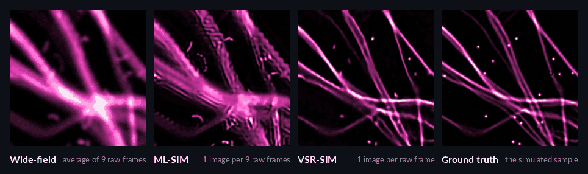

<h1 align="center">VSR-SIM</h1>

<p align="center">
  <b>Super-resolution microscopy for samples that will not hold still.</b><br>
  A video transformer that reconstructs structured illumination microscopy through motion,<br>
  and returns an image for every raw frame instead of one for every nine.
</p>

<p align="center">
  <a href="https://arxiv.org/abs/2203.00030"></a>
  <a href="https://github.com/charlesnchr/VSR-SIM/releases/tag/v1.0"></a>
  <a href="LICENSE"></a>
</p>

<p align="center">
  
</p>
<p align="center">
  <sub>A simulated acquisition of microtubules that move one camera pixel per raw frame, with beads on paths of their own. The first three panels come from the same raw frames, and ML-SIM reconstructs each stack of nine on its own. Run <code>python reconstruct.py --rolling examples/Sequence_microtubules.tif</code> to reproduce the VSR-SIM panel.</sub>
</p>

Structured illumination microscopy (SIM) doubles the resolution of a fluorescence microscope, with little enough light to image living cells. The catch is that one super-resolved image takes nine exposures, and the reconstruction assumes that the sample held still for all nine. Living cells do not. Whatever moved between the first exposure and the last comes out doubled, smeared or covered in stripes. The usual way round it is a shorter exposure, which costs signal.

VSR-SIM treats the nine exposures as a short video. A transformer with windowed self-attention and channel attention takes all nine frames at once and reconstructs the sample as it was at the middle of the stack. There is no optical flow and no motion model. The network learned this from 200 hours of BBC nature documentaries passed through a simulation of the microscope, and it has never been trained on a real SIM image.

- **Motion does not break it.** On the paper's test set of moving scenes VSR-SIM scores 30.15 dB. ML-SIM scores 18.41 dB, and the classical methods CC-SIM, FairSIM and OpenSIM all score below the unprocessed wide-field image at 17.31 dB.
- **Nine times the frame rate.** The network was trained with the illumination patterns in shuffled order, so it reconstructs any nine consecutive frames. Slide the window one frame at a time and N raw frames give N - 8 images instead of N / 9.
- **No optical flow.** The stripes change from frame to frame, and flow estimators mistake that for motion. Attention alone does better. RBPN, a video super-resolution network built on optical flow, scores 29.25 dB on the same moving scenes.
- **Trained on simulation only.** The training set is 100,000 nine-frame clips of nature footage, each passed through a SIM image formation model with randomised stripe frequency, phase, modulation depth and noise. The targets are the original frames, so they carry none of the motion artefacts that a classical reconstruction would put into them.
- **Runs with one command.** `python reconstruct.py --examples` downloads the weights and the example data and reconstructs it.

## Try it

```bash
git clone https://github.com/charlesnchr/VSR-SIM && cd VSR-SIM
pip install -r requirements.txt
python reconstruct.py --examples
```

The first run downloads the pre-trained weights (179 MB) and nine example files (41 MB), and checks their SHA-256. Each 9-frame stack in `examples/` gets a wide-field image and a VSR-SIM reconstruction in `reconstructions/`. A GPU is used when one is available. On a CPU a 512x512 stack takes about a minute.

The examples include a sequence of 80 raw frames of a moving sample. Rolling reconstruction turns it into 72 images, which takes about ten minutes on a CPU.

```bash
python reconstruct.py --rolling examples/Sequence_microtubules.tif
```

To run it on your own data, pass TIFF stacks whose first nine frames are the raw acquisition, three pattern orientations with three phase shifts each. The output has twice as many pixels in each direction. With `--rolling` every frame of the TIFF is a raw frame, and the nine patterns have to keep cycling in the same order for the whole acquisition.

## Layout of repository

- Powershell script for video dataset sampling:
    - `scripts/sample_documentary_videos.ps1`
- Python code for image formation model:
    - `scripts/im_form_model/SIMulator.py`
- Data generation script:
    - `scripts/datagen_pipeline.py`
- Model architecture based on Pytorch:
    - `basicsr/archs/vsr-sim_arch.py`
- Training code:
    - `basicsr/train.py`
- Inference code for testing:
    - `inference/inference_options.py`
- RBPN code base based on official implementation:
    - `RBPN-PyTorch`

## Video sampling

Given a collection of .mp4 and .mkv video containers, we use the FFMPEG library to sample the collection with a time interval of 5 seconds between sequences. The script is launched using Powershell with

```
pwsh scripts/sample_documentary_videos.ps1
```


## Data generation
The image formation pipeline can be used as follows
```
python datagen_pipeline.py --root TRAINING_DATA_DIRECTORY \
    --sourceimages_path SAMPLED_IMAGE_SEQUENCE_DIRECTORY --nrep 1\
    --datagen_workers 10 --imageSize 512  --nch_in 9 --nch_out 1\
    --ntrain 100000 --ntest 0 --scale 2 --nepoch 100 --scheduler 20,0.5\
    --norm minmax --workers 6 --dataonly --NoiseLevel 8 \
    --NoiseLevelRandFac 8 --Nangle 3 --Nshift 3 --phaseErrorFac 0.05 \
    --alphaErrorFac 0.05 --seqSIM --ext imagefolder
```


## Training
To train a model with the VSR-SIM architecture using options specified in an associated options file, run the following
```
PYTHONPATH="./:${PYTHONPATH}" python basicsr/train.py \
    -opt options/train/VSR-SIM/VSR-SIM.yml
```

## Hyperparameters used in VSR-SIM and referenced methods
See [Hyperparameters.md](Hyperparameters.md) for an overview of the parameters used in models in the paper. The parameters are also given in the individual YAML files in the `options` folder.

## Credits
The implementation of VSR-SIM and structure of the code is inspired by the following repositories. Reference implementations for methods that are compared to in the paper are also listed. See [Hyperparameters.md](Hyperparameters.md) for parameters used.

-   **SwinIR** [@Liang2021]\
    Reference implementation: SwinIR:\
    <https://github.com/JingyunLiang/SwinIR>

-   **Video Swin** [@Liu2021a]\
    Reference implementation: Video-Swin-Transformer:\
    <https://github.com/SwinTransformer/Video-Swin-Transformer>

-   **RBPN** [@Haris2019]\
    Reference implementation: RBPN-PyTorch:\
    <https://github.com/alterzero/RBPN-PyTorch>

-   **RCAN** [@Zhang2018d]\
    Reference implementation: BasicSR [@wang2020basicsr]:\
    <https://github.com/xinntao/BasicSR>

